# Introduction

Blade inspection by drone is one of the more mature applications of defect detection, and the published numbers suggest a nearly solved problem. BladeYOLO [@bladeyolo] reports 86.5 / 57.4 mAP50 / mAP50-95 on Wind Surface Defect and 85.8 / 74.6 on WTBlade-Defect, and other recent architectures report similar levels [@gfdyolox; @gayolo; @kgpyolo]. This work began as an attempt to reproduce one of those results and build on it. The closest faithful reimplementation we could build stopped at about 52.6 / 28, and our next model reached 78.2 / 46.9, until we found that three-quarters of the validation images had a near-identical twin in the training set. That finding changed the question from "how do we beat this number?" to three others:

1. What do these benchmarks measure?
2. How much of a reported score is memorisation of scenes seen in training?
3. Once leakage is removed, what actually helps, and what limits the score?

We answer them with an end-to-end audit and about two months of controlled experiments. Our contributions are measurements, not a new architecture. We tried to find a method that survives a second dataset, and did not; §[-@sec:failed] reports those attempts.

- **A leakage audit of the public blade benchmarks** (@tab:audit, @fig:twins). A literature check found no earlier audit of these datasets. The check was not exhaustive.
- **The size of the inflation**, on the same detector and recipe: leaked against no-twin test images (@tab:subsets), and official against scene-grouped splits (@tab:split-only, @fig:benchmark).
- **Evidence that tuning on leaky benchmarks selects for memorisation** (@tab:tuning, @fig:tuning). This analysis is post hoc and covers one tuning step.
- **Two leak-free benchmarks**, WTBD-group and WTBlade-group, with audited splits, scene groups and a scene bootstrap (§[-@sec:benchmarks]), and baselines for RF-DETR, a DINOv3-fused YOLO and stock YOLO12-L (@tab:leakfree).
- **Controlled ablations** that attribute the low-label and full-label advantage of a DINOv3-fused YOLO to the frozen features alone (@tab:ablation, @fig:curve).
- **Measured ceilings**: annotator self-consistency, box granularity, subset luck and error anatomy (§[-@sec:why]).
- **A leave-one-dataset-out test** with twin-free pools (§[-@sec:lodo]), and a recall-guarantee failure caused by leaked calibration (@tab:conformal).
- **A ledger of the method tests we ran or formally gated**, including the failures (@tab:ledger), and an account of how our own early numbers were wrong (§[-@sec:history]).

The authors of the papers we discuss followed common practice, which is to augment and then split at random. Our argument is about the protocol, not about them. We cannot say that any specific published number is due to memorisation, because those splits were not published.

@fig:pipeline shows how the parts of the study fit together.

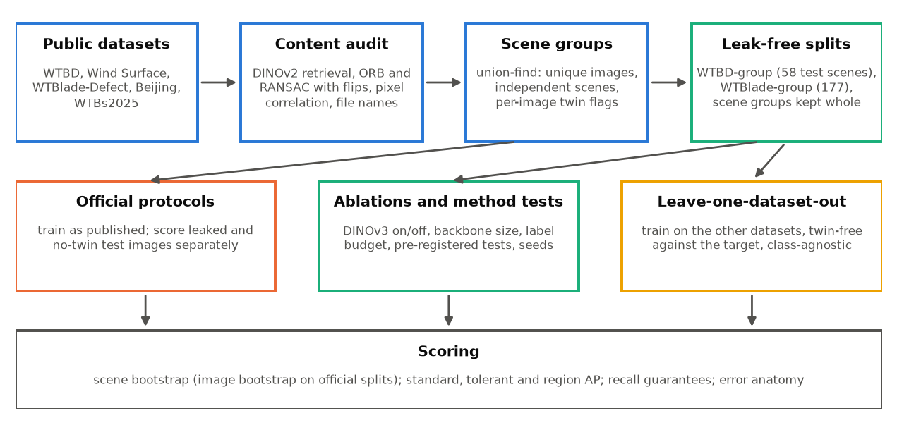{width=92%}

# Related work

**Blade defect detection.** Most work adapts YOLO variants with attention, wavelet, deformable or Mamba-style modules [@bladeyolo; @gfdyolox; @gayolo; @kgpyolo], and several build on the DTU NordTank drone inspection imagery [@shihavuddin; @foster]. BladeYOLO fuses frozen DINOv3 ViT-S/16 features into YOLOv12-L [@bladeyolo; @yolov12], close in spirit to DINO-YOLO in civil engineering [@dinoyolo]. Data-descriptor papers have added new sets, notably WTBD [@wtbd] and WTBs2025 [@wtbs2025]. Training-free language-model inspection [@seeingunseen] and box-to-mask supervision [@boxes2pixels] are recent directions, and we have not tested those specific claims on a leak-free split.

**Leakage and near-duplicates.** Near-duplicates between train and test are documented for CIFAR [@barz], geospatial mapping data [@adimoolam] and more generally as a source of irreproducible machine-learning results [@kapoor]; and a fresh test set can show lower accuracy than a reused one [@recht]. Long-tail memorisation is a mechanism by which rare test examples are classified correctly through similar training examples [@feldman]. We apply this line of work to blade defect benchmarks, and add a same-detector measurement of what the leak buys and what tuning on it rewards.

**Foundation detectors.** RF-DETR [@rfdetr] fine-tunes DINOv2 [@dinov2] end to end and is strong on Roboflow100-VL [@rf100vl]. DINOv3 [@dinov3] offers frozen dense features. Fine-tuning can distort pretrained features under distribution shift [@lpft].

**Label noise and granularity in evaluation.** TedEval [@tedeval] handles split and merged instances in text detection. Box-annotation noise has been studied in detection evaluation [@murrugarra] and in repeated labels [@tschirschwitz], and box regression can model its own uncertainty [@klloss]. We measure the same kind of ambiguity from accidental repeated labels: independently annotated copies of the same image.

**Calibration and subset variance.** Conformal risk control [@crc] gives distribution-free guarantees under exchangeability, and has been applied to detection [@andeol]. Few-shot detection results vary strongly with the sampled shots [@tfa]; we measure that variance in a realistic low-label setting and test label-free selection [@freesel].

**Multi-dataset and domain generalisation.** Multi-dataset detection with partitioned label spaces [@multidataset] and training-domain model selection [@domainbed] inform our G27 and G28 designs. Copy-paste [@copypaste] is a known augmentation, and we test it only as a recipe component.

# Datasets and the leakage audit {#sec:audit}

## Datasets

We work with the official classes of each dataset, because the taxonomies conflict (below). @fig:gallery shows random labelled examples and @tab:audit summarises the audit.

![@DEF fig:gallery. Random labelled training images from each dataset (fixed seed; the first three in each row are required to show a class not yet shown). Colour marks the class within a row. Note the differences in viewpoint and box style, from close-ups with one box (WTBD) to chains of small boxes along an edge (Wind Surface, Beijing) and very small boxes (WTBs2025). Black squares in WTBlade-Defect are the Roboflow export's offline cutout augmentation. Source licences are in §[-@sec:availability].](figures/fig8_dataset_gallery.jpg){width=88%}

: @DEF tab:audit. The three benchmarks and their official splits. Unique images and scenes are from the content-based audit. A *twin* is a near-copy or same-scene image among the images the run trained on.

| dataset | files | unique images | independent scenes | official split (train / val / test) | test images with a training twin | how the twin arises |
|---|---|---|---|---|---|---|
| WTBD [@wtbd] | 1,065 | 597 | ~550 | 745 / 159 / 161 | **125 / 161 (78%)** | duplicate and augmented copies of one photo, split at random (seed 42) |
| Wind Surface Defect [@gfdyolox], used by BladeYOLO | 3,570 | 954 | **81** | 2,856 / 714 (val = test) | **600 / 714 (84%)** pixel twins (corr ≥ 0.99) | 1,785 originals plus one augmented copy each (550 pairs split across train and val); up to 44 tiles per drone photo (386 of 882 photos on both sides) |
| WTBlade-Defect [@fengche], used by BladeYOLO | 10,660 | 1,146 | 803 | 9,010 / 1,097 / 553 | **499 / 542 (92%)** same scene; **360 (66%)** copies of a training frame | about 3 Roboflow augmentation copies per source frame; consecutive drone-video frames |

## Audit method

Files cannot be compared by name or hash, because the copies are flipped, rotated, recoloured or re-encoded. We combine several signals:

1. **Retrieval:** DINOv2 embeddings [@dinov2], cosine nearest neighbours.
2. **Geometric verification:** flip-aware ORB matching with a RANSAC similarity transform, at least 25 inliers.
3. **Pixel twins:** correlation at 48 px over the eight flips and rotations, at least 0.99.
4. **Provenance from file names:** Roboflow source prefixes, `DJI_xxxx_r_c` tile coordinates, and `_0` / `_1` pairs.
5. **Grouping:** union-find over all of the above, with DINOv2 cosine ≥ 0.93 counted as same scene. Deduplication is non-chaining, so that a chain of weak matches cannot merge unrelated images.

Example sheets were checked by eye for every dataset and outcome. On Wind Surface the first pixel comparison, flips only, found 532 of 714 validation images (75%); adding rotations and restricting to the images actually trained on gives 600 (84%). The Wind Surface "no twin" subset has no near-identical copy in training, but most of it comes from drone photos with other tiles in training, so it is cleaner rather than leak-free.

@fig:twins shows test images and their training twins, drawn at random.

{width=100%}

## What the file counts hide

File count is a poor guide to the information in a dataset (@fig:size). Wind Surface's 3,570 files come from about 81 independent scenes, and all `surface_eye` boxes (412 in the raw files, 103 after deduplication) come from tiles of a single photo. Any `surface_eye` score on the original split, including published ones, was measured on tiles of a training photo. WTBD has far fewer files and far more independent scenes per class. Three more findings limit what can be merged:

- **Same-named classes do not match across datasets.** Mutual crop retrieval between same-named classes is at most 0.33, apart from the two Beijing exports, which are the same data.
- **Datasets overlap under other names.** WTBs2025 shares 1,499 images with WTBlade-Defect under different class names (peeling → erosion). Beijing contains WTBD test photos.
- **Licences are not what the export pages say.** "NORDTANK" is legible on many WTBlade-Defect nacelles, so the set contains DTU imagery [@shihavuddin], which is CC BY-NC, while its Roboflow page states CC BY 4.0. It also contains synthetic copy-paste images.

{width=96%}

The same augment-then-split pattern appears in other published work: 130 DTU images expanded to 780 and then split 624 / 78 / 78 [@kgpyolo], and CLAHE copies with a random 60 / 40 split of repeated shots of one turbine [@gayolo]. BladeYOLO's WTBlade numbers use its authors' own 9:1 re-split of 5,326 images, which is not public [@bladeyolo].

# Leak-free benchmarks, models and evaluation {#sec:benchmarks}

## Splits

**WTBD-group.** The 1,065 WTBD images are split by scene into 745 / 159 / 161 images (the official sizes), with 1,109 / 240 / 235 boxes and 224 / 60 / 58 scene groups. The split was audited until no held-out image matched train under DINOv2 and ORB verification. Fractions of 25% and 50% are nested subsets of training scenes.

**WTBlade-group.** From 10,527 WTBlade-Defect images (133 that match WTBD are left out, so the benchmarks share nothing), we form 841 groups from 2,791 source frames, verified pairs and DINOv2 neighbours. A class-stratified 70 / 15 / 15 split over groups converged with no held-out or train match after 11 rounds of the audit. We keep one image per source frame, giving 2,136 / 323 / 332 frames, 5,237 / 729 / 748 boxes, and 177 test scenes, with all seven classes in every split.

**A residual leak in our own splits.** While building a later pool we added the pixel test to our audit and ran it on these splits. It found copies that DINOv2 and ORB had missed: 6 of 161 test and 6 of 159 validation images on WTBD-group, and 1 of 332 and 1 of 323 on WTBlade-group (@fig:residual). All six WTBD-group test pairs are real copies by eye, re-exposed, darkened, tinted or rotated. Rescoring 116 cached WTBD-group runs without those images changes mAP50-95 by −0.62 on average (range −1.09 to +0.33) and mAP50 by −0.70, and 20 WTBlade-group runs by ±0.03. Our leak-free numbers are therefore inflated by under a point. We kept the splits unchanged, so that every comparison stays like for like, and report the G27 and G28 decisions both ways (§[-@sec:failed], §[-@sec:lodo]). Neither changes. So a leak-free split needs the pixel test next to scene grouping, and "audited" is only as good as the audit.

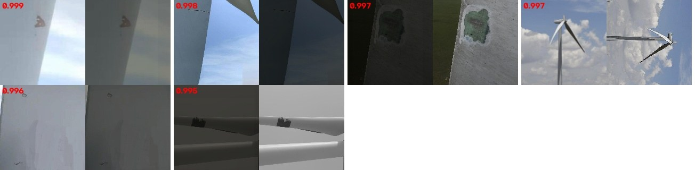{width=78%}

## Models and recipes

- **YOLO12-L:** COCO-pretrained, stock, CIoU loss, AdamW (lr 0.001, weight decay 0.01), cosine schedule, mosaic. 150 epochs on WTBD and 50 on WTBlade-group.
- **BladeYOLO-v2:** our model, on the same recipe. A COCO-pretrained YOLOv12-L [@yolov12] with three zero-initialised residual additions, so that training starts exactly at the pretrained detector: frozen DINOv3 [@dinov3] features fused at P3 / P4 / P5, deformable refinement at P3 / P4 [@dcnv2], and four-direction selective scan at P5 [@vmamba; @mamba]; WIoU v3 loss [@wiou]. 53.7 M parameters with ViT-S/16.
- **RF-DETR-M:** `rfdetr` 1.11.2 [@rfdetr], fine-tuned end to end from its COCO checkpoint. Batch 4 × accumulation 4 (effective 16), cosine schedule, EMA checkpoint selected on validation. WTBD at 768 px for 100 epochs; WTBlade at 640 px for 60 epochs.

Runs used Kaggle Tesla T4 (fp16 mixed precision) and one A100 (bf16). All G27 seed-1 runs were on the A100 and seed-0 runs on Kaggle, so every pair of arms within a seed shares hardware.

## Evaluation

**Selection and reporting.** Model selection uses validation only, and results are reported on test. Wind Surface has no separate test split, so we carve a seeded 10% of train for validation.

**Evaluators.** We use a 101-point COCO-style evaluator [@coco] (`tools/bootstrap_ci.py`). On identical predictions it agrees with Ultralytics' `ap_per_class` within 0.4 points on every run and subset, so gaps to published figures are not an artefact of the metric. Ultralytics' `val` reports differ by 1–2.5 points from cached predictions because of its rectangular-batch inference path. Tables state which is used.

**Intervals.** Test images of one scene are correlated, so on group splits we resample whole scenes, paired across models (2,000 replicates unless noted). Official splits have no scene groups, so those intervals are image-level and therefore narrower than they should be. All intervals are 95%.

**Three box scores.** *Standard* AP is one-to-one matching at IoU ≥ 0.5. *Tolerant* AP lets one prediction match several same-class labels whose union it fits, and ignores fragments of an already found defect. *Region* AP is pixel-level precision and recall of the union of predicted boxes against the union of labels (4 px grid), so it does not depend on how a defect is split into boxes.

**Pre-registration.** From late October, hypotheses were written down with their pass bars before any run or computation, and committed. After a bad result we allow one scope check, on whether any part is usable, and then discard the hypothesis without rescue runs. Post hoc analyses are labelled as such.

# Official protocols: the scores and what they are made of {#sec:official}

## Our numbers against published

@tab:official gives our scores on the official protocols. A generic detector with a standard recipe, and no blade-specific modules, reaches the level of the specialised models on two protocols, but not on Wind Surface.

: @DEF tab:official. Official protocols: this work against published. mAP50 / mAP50-95, single seed, selected on validation; intervals are image-level. BladeYOLO's WTBlade numbers use its own unpublished 9:1 re-split, so that row is not directly comparable.

| protocol | model | mAP50 / mAP50-95 [95% CI] |
|---|---|---|
| WTBD-official (test 161) | YOLO12-L (ours, Ultralytics) | 70.4 / 38.8 |
| | BladeYOLO-v2 (ours, Ultralytics) | 84.0 / 49.3 |
| | RF-DETR-M 768, constant LR (G25) | 90.5 [86.3, 94.4] / 60.2 [55.6, 65.3] |
| | **RF-DETR-M 768, cosine (G26)** | **90.4** [85.8, 94.7] / **61.2** [56.5, 66.1] |
| | RF-DETR-L 704, cosine (G26) | 88.9 / 59.5 |
| Wind Surface (val 714) | BladeYOLO [@bladeyolo] | **86.5 / 57.4** |
| | our best leaky BladeYOLO-L | 78.2 / 46.9 |
| | RF-DETR-M 640, 60 ep, constant (G25) | 81.8 [78.0, 85.4] / 51.4 [48.3, 55.0] |
| | RF-DETR-M 640, 100 ep, cosine (G26) | 81.0 [77.1, 84.9] / 53.3 [50.0, 57.0] |
| WTBlade-Defect (test 553) | BladeYOLO [@bladeyolo] | 85.8 / **74.6** |
| | YOLOv12-L, as reported there | 83.3 / 71.9 |
| | RF-DETR-M 640, 25 ep, constant (G25) | 87.4 [84.4, 90.9] / 52.5 [49.6, 56.2] |
| | **RF-DETR-M 640, 40 ep, cosine (G26)** | **87.2** [84.0, 90.6] / 55.1 [52.0, 59.1] |

To our knowledge, the WTBD-official row is the best reported on that protocol; the dataset paper itself gives no detection baselines [@wtbd]. On Wind Surface, our copy has 3,570 images against the 3,790 reported by BladeYOLO, so the splits differ.

**The mAP50-95 / mAP50 ratio.** The ratio on WTBlade is 0.87 in the BladeYOLO paper and 0.86 for its YOLOv12-L baseline. RF-DETR's ratio on WTBlade copies of training frames is 0.71, on all official test images 0.63, and on no-twin images 0.34. Across all our leak-free runs it spans 0.41–0.60. A ratio of 0.87 sits above every one of these. This is consistent with near-duplicate copies falling on both sides of a random split, but it is not proof, because that split is not available.

## Leaked and no-twin test images

Using the per-image flags from the audit, we score the same official runs on the two subsets (@tab:subsets, @fig:leak).

: @DEF tab:subsets. The same official runs on leaked and no-twin test images (COCO-style evaluator, mAP50 / mAP50-95 [95% CI], post hoc). Subset sizes (images / boxes): WTBD 125 / 185 leaked and 36 / 53 no twin; Wind Surface 600 / 1,169 and 114 / 158; WTBlade 499 / 1,235 and 43 / 91.

| protocol, run | all | leaked | no twin |
|---|---|---|---|
| WTBD-official, YOLO12-L | 69.0 / 37.7 | 69.7 / 38.5 | 70.0 / 35.2 |
| WTBD-official, BladeYOLO-v2 | 81.5 / 48.1 | 82.6 / 48.9 | 81.5 / 47.8 |
| WTBD-official, RF-DETR-M 768 cosine | 90.4 / 61.2 | 91.5 / 63.9 | 81.6 [69.1, 93.2] / 49.9 [40.4, 61.1] |
| Wind Surface, RF-DETR-M cosine | 81.0 / 53.3 | 83.3 / 55.1 | **59.2** [49.0, 68.1] / **37.6** [29.9, 45.4] |
| WTBlade-Defect, RF-DETR-M cosine | 87.2 / 55.1 | 90.8 / 59.4 | **50.4** [38.5, 64.0] / **17.2** [13.5, 23.4] |
| WTBlade-Defect, copies of a training frame (360) | | **98.2** [97.7, 98.8] / **69.8** [67.8, 72.5] | |
| WTBlade-Defect, same scene, not a copy (139) | | 65.7 / 30.1 | |

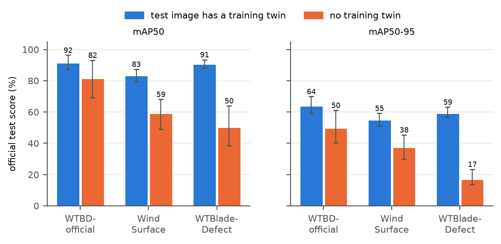{width=88%}

WTBlade-Defect's official number is mostly its copies: 98.2 on copies of training frames and 50.4 with no same-scene training image. The independently built WTBlade-group benchmark agrees from a different direction: its RF-DETR-M runs score 16.1–17.3 mAP50-95 (@tab:leakfree) against 17.2 here. Their 38.5–41.8 mAP50 is inside this small subset's interval of [38.5, 64.0].

WTBD's no-twin subset is too small to read on its own: it holds a single box each of craze, thunderstrike and crack. Corrosion is the only class with a clear drop (AP50 97 to 54). The split comparison below is therefore the stronger evidence for WTBD.

## Same detector, only the split differs

@tab:split-only and @fig:inflation compare models trained on the same 1,065 WTBD images, official against scene-grouped.

: @DEF tab:split-only. Same recipe, only the WTBD split differs. Test AP50 by class and overall mAP50 / mAP50-95. BladeYOLO-v2 and YOLO12-L use Ultralytics `val` and trained for 120 epochs on the official split and 150 on the group split. RF-DETR-M uses the COCO-style evaluator (seed 0), 768 px and 100 epochs on both splits, with an effective batch of 16 on both (2 × 8 and 4 × 4).

| class | BladeYOLO-v2 official | BladeYOLO-v2 group | YOLO12-L official | YOLO12-L group | RF-DETR-M official | RF-DETR-M group |
|---|---|---|---|---|---|---|
| crack | 99.1 | 38.1 | 85.4 | 38.4 | 95.3 | 61 |
| craze | 90.9 | 7.6 | 62.2 | 6.5 | 95.3 | 9 |
| hide_craze | 80.0 | 56.9 | 63.9 | 52.6 | 80.3 | 71 |
| surface_injure | 81.6 | 74.7 | 71.1 | 62.9 | 91.0 | 83 |
| thunderstrike | 99.5 | 98.0 | 93.8 | 41.8 | 94.3 | 64 |
| corrosion | 52.7 | 53.8 | 46.0 | 60.8 | 86.0 | 46 |
| **all** | **84.0 / 49.3** | **54.8 / 24.5** | **70.4 / 38.8** | **43.8 / 20.6** | **90.4 / 61.2** | **55.3 / 33.2** |

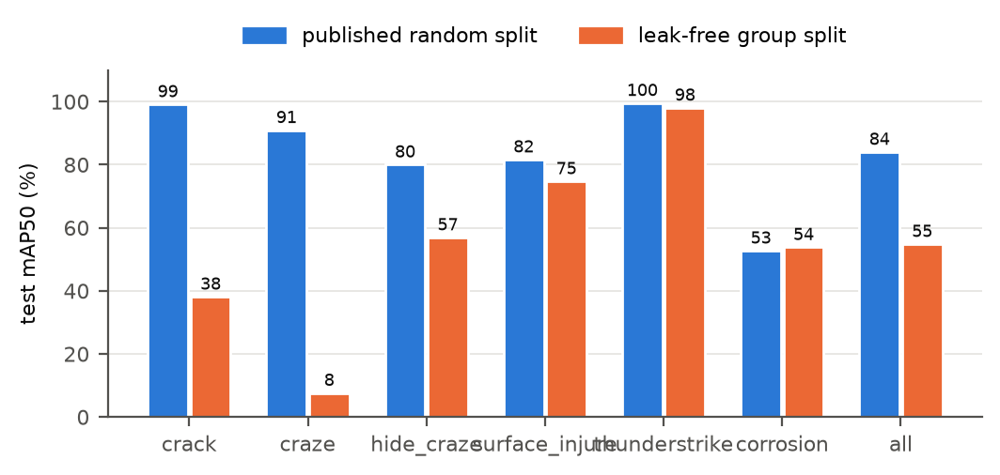{width=78%}

The inflation is model-independent: +29.2 mAP50 for BladeYOLO-v2, +26.6 for YOLO12-L and +35.1 for RF-DETR-M, with mAP50-95 multiplied by 2.0, 1.9 and 1.8. @fig:benchmark (c) adds WTBlade: 87.2 / 55.1 officially and 38.5 / 16.2 on WTBlade-group. That second pair is not a pure split comparison, because WTBlade-group also keeps one frame per source and 60 rather than 40 epochs.

## Tuning on the official splits rewards memorisation

Between G25 and G26 we made one tuning step in the usual spirit, moving to a cosine schedule (and on two protocols, longer training) because the official numbers improved. @tab:tuning decomposes what that step bought (post hoc).

: @DEF tab:tuning. What one tuning step bought. Paired image bootstrap, Δ mAP50-95 in points = G26 recipe − G25 recipe, same images. Interaction = Δ leaked − Δ no twin, with the subsets resampled independently.

| protocol (change) | Δ all | Δ leaked | Δ no twin | interaction, P(>0) |
|---|---|---|---|---|
| WTBD-official (constant → cosine) | +1.0 [−1.2, +3.0] | +1.8 [−0.1, +4.0] | −8.1 [−13.4, +0.2] | +9.9 [+1.1, +15.8], 0.993 |
| Wind Surface (60 ep constant → 100 ep cosine) | +1.8 [+0.5, +3.1] | +2.3 [+0.9, +3.8] | −1.5 [−4.2, +1.4] | +3.8 [+0.7, +7.0], 0.988 |
| WTBlade-Defect (25 ep constant → 40 ep cosine) | +2.6 [+1.1, +3.9] | +3.5 [+2.0, +5.0]; copies +5.4 [+3.6, +7.0] | −4.0 [−7.2, +0.1] | +7.4 [+3.0, +11.1], 1.000 |

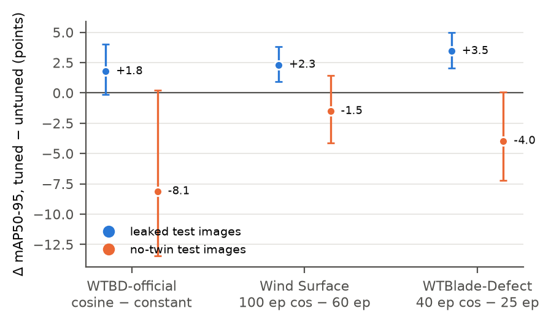{width=84%}

On every protocol the gain sits on leaked images, and the same change lowers the score on images without a twin. At mAP50 the change is −0.2 to −0.8 overall and −5.0 to −6.0 on no-twin images. The interaction excludes zero on all three. This applies to our own G26 numbers, which stay in @tab:official labelled as what they are. Two confounds remain: on Wind Surface and WTBlade-Defect the epoch count also changed (on WTBD only the schedule changed, with the same pattern), and this is one tuning step, not a study of tuning in general.

A second reading comes from the leaderboard itself. RF-DETR-M leads BladeYOLO-v2 on WTBD-official by +13.2 [+8.2, +17.4] mAP50-95 on all images, but by only +2.1 [−5.3, +19.8] on the 36 no-twin images, so that official lead is not established on unseen images.

## Consequence for deployment: leaked calibration breaks recall guarantees

An inspection system should promise a bound on missed defects. Conformal risk control [@crc] picks a confidence threshold so that the expected share of missed defects is at most α. A defect counts as flagged if at least 50% of its box is covered by predictions above the threshold. We calibrate on seen or unseen scenes and always deploy on unseen scenes (@tab:conformal, @fig:conformal).

: @DEF tab:conformal. Conformal recall guarantee, target ≤ 10% missed (BladeYOLO-v2, 500 draws of 100 calibration images, or scene groups as units).

| calibrated on | deployed on | realised miss rate | draws violating |
|---|---|---|---|
| seen scenes (group train), image units | unseen scenes | **31.5%** | 100% |
| seen scenes, scene units | unseen scenes | 28.8% | 100% |
| unseen scenes (group val), image units | unseen scenes | 6.3% | 0% |
| unseen scenes, scene units | unseen scenes | 4.7% | 1% |
| official val (leaky) | official test, images with a twin | 12.6% | 91% |
| official val (leaky) | official test, no-twin images | **25.9%** | 100% |

{width=92%}

Models are overconfident on what they memorised, so a threshold calibrated on seen scenes is too high for new data. The practical rule is that calibration data must be split by scene, as test data must. The honest calibration is cheap: 0.2 instead of 0.1 false alarms per image. With only 60 calibration and 58 deployment scenes from one site, the val and test groups are not perfectly exchangeable: YOLO12-L still misses 12.3% with scene-unit calibration on unseen scenes, violated in 71% of draws.

# Leak-free results: what helps {#sec:leakfree}

## The benchmark at full labels

@tab:leakfree, @fig:benchmark and @fig:perclass give the benchmark, all with one evaluator.

: @DEF tab:leakfree. Leak-free benchmark, full labels, test mAP50 / mAP50-95, COCO-style evaluator on cached predictions. YOLO12-L on WTBlade-group trained for 50 epochs, reached its best validation at epoch 43, and rose almost linearly until then (@fig:training f), so its row may understate it. No paired interval was computed for the cross-architecture comparisons in this table, so treat them as point estimates.

| model | WTBD-group (161 images, 58 scenes) | WTBlade-group (332 frames, 177 scenes) |
|---|---|---|
| YOLO12-L | 40.0 / 18.5 | 32.2 / 13.3 |
| BladeYOLO-v2 without DINOv3 | 31.8 / 15.2 | not run |
| BladeYOLO-v2 | 56.1 / 24.4 (ViT-S) | 41.8 / 18.0 (ViT-B) |
| RF-DETR-M, A0, seeds 0 / 1 | 55.3 / 33.2, 54.8 / 32.2 | 38.5 / 16.2, 41.0 / 16.9 |
| RF-DETR-M + copy-paste, A1, seeds 0 / 1 | 51.5 / 30.7, 58.5 / 32.7 | 41.8 / 17.3, 39.3 / 16.5 |
| RF-DETR-M + copy-paste + in-domain SSL, A2 | 49.6 / 27.4 | 40.1 / 16.1 |
| RF-DETR-M + copy-paste + multi-dataset stage 1, A3 | 55.3 / 33.2 | 41.7 / 16.6 |

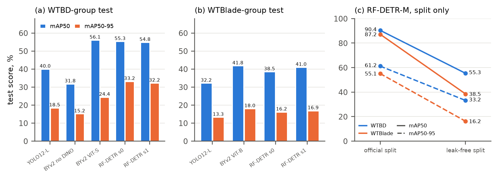{width=100%}

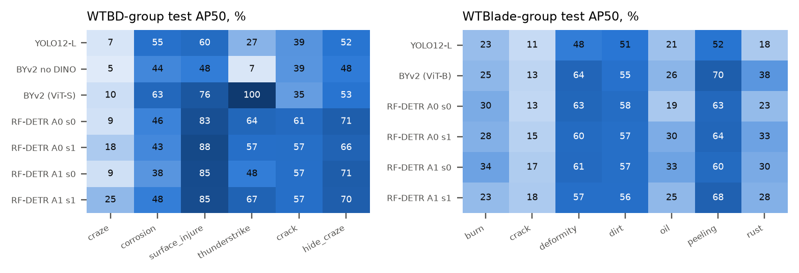{width=98%}

Four points stand out:

- **The ranking depends on the dataset.** RF-DETR-M leads on WTBD-group by 8–9 mAP50-95 points over BladeYOLO-v2, but on WTBlade-group the frozen ViT-B BladeYOLO-v2 (18.0) is ahead of every RF-DETR run (16.1–17.3). A "generic detector is strongest" claim holds on one benchmark.
- **On WTBD the RF-DETR gain is box quality, not finding.** mAP50 is level with BladeYOLO-v2 (55.3 and 54.8 against 56.1) while mAP50-95 is 8–9 points higher. This matches the extent analysis in §[-@sec:why].
- **Classification costs points on RF-DETR.** Scoring A0 with classes merged gives 66.1 / 40.5 on WTBD-group and 50.1 / 21.3 on WTBlade-group (@tab:g28), about 11 AP50 points above its class-aware score. BladeYOLO-v2's class-agnostic and class-aware AP50 are about equal (56.3 against 56.1), while YOLO12-L shows a gap like RF-DETR's (48.5 against 40.0).
- **The earlier BladeYOLO-v2 win over YOLO12-L rests largely on thunderstrike.** The scene bootstrap gives +16.1 [+2.5, +28.4] mAP50 and +5.9 [+0.5, +16.9] mAP50-95, but without the two classes seen in at most 3 test scenes the mAP50 gain is +5.2 [−2.7, +13.5].

## Where the advantage comes from: DINOv3 ablation

We removed only the frozen DINOv3 features from BladeYOLO-v2, keeping deformable refinement, selective scan and WIoU, at 25%, 50% and 100% of the labelled scenes (@tab:ablation, @fig:curve).

: @DEF tab:ablation. DINOv3 ablation and learning curve, WTBD-group, test mAP50-95, scene bootstrap. Last row: stock YOLO12-L compared with our modules without DINOv3.

| | 25% | 50% | 100% |
|---|---|---|---|
| BladeYOLO-v2 (frozen DINOv3 ViT-S) | 7.6 (3 seeds) | 17.5 | 24.2 (2 seeds) |
| without DINOv3 | 3.7 (2 seeds) | 8.8 | 15.2 |
| YOLO12-L (stock) | 4.1 | 9.9 | 18.5 |
| **DINOv3 gain** | **+3.9 [+2.5, +10.1]** | **+8.8 [+4.0, +22.1]** | **+9.0 [+4.0, +20.5]** |
| same, 4 well-represented classes | +4.4 [+2.3, +11.1] | +6.1 [+2.2, +17.9] | +4.9 [−1.8, +10.3] |
| YOLO12-L − without DINOv3 | +0.4 | +1.1 | +3.3 [−0.2, +13.1] |

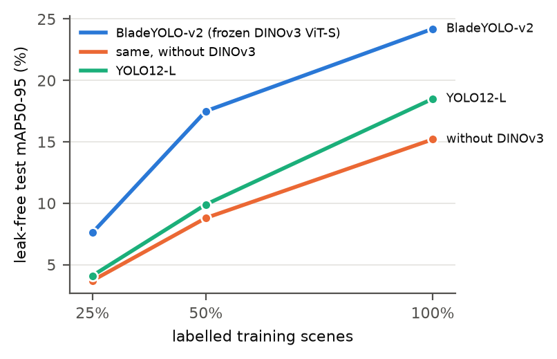{width=74%}

Without DINOv3, BladeYOLO-v2 equals or trails stock YOLO12-L at every data size. The advantage is therefore the features, not the architecture around them. We first read it as a low-data advantage; the 50% and 100% runs corrected that, since the absolute gain does not shrink with data. Only the relative gain does (2.0× to 1.6×). This claim concerns our components. BladeYOLO's exact Style Injection, WTConv and Cross-Mamba modules were reimplemented only before our code audit (§[-@sec:history]), so we make no claim about them.

**Backbone size at 25%** (@tab:backbone). A larger frozen backbone helps up to ViT-B, and ViT-L adds nothing further.

: @DEF tab:backbone. Frozen DINOv3 size at 25% of WTBD-group scenes. Test scores by Ultralytics `val`; differences by scene bootstrap, mAP50-95 in points.

| backbone | test mAP50 / mAP50-95 per seed | difference | Δ mAP50-95 [95% CI] |
|---|---|---|---|
| ViT-S/16, 3 seeds | 23.2 / 8.2, 22.4 / 8.7, 18.4 / 6.8 | | |
| ViT-B/16, 2 seeds | 25.2 / 10.2, 28.3 / 11.6 | ViT-B − ViT-S | +2.8 [+0.4, +9.6] |
| ViT-L/16, 2 seeds | 33.7 / 11.5, 30.1 / 10.9 | ViT-L − ViT-B | +0.3 [−4.0, +3.1] |
| without DINOv3, 2 seeds | 11.4 / 4.4, 8.1 / 3.1 | without − ViT-S | −3.9 [−10.1, −2.5] |

**Fine-tuned against frozen foundation features, 25% labels, same subsets.** RF-DETR-M beats BladeYOLO-v2 ViT-B by +7.3 [+2.3, +11.9] mAP50-95 (seed 0) and +8.3 [+4.5, +15.0] (seed 1), positive on 4 of 4 subsets at each seed. As a controlled comparison, freezing RF-DETR's encoder lowers test mAP50-95 from 18.9 to 12.3 on WTBD and from 13.2 to 8.7 on WTBlade. Input resolution (G24) adds +1.0 from 576 to 768 on WTBD (P 0.958) and −0.1 on WTBlade, whose frames are natively 640 px.

## Training behaviour

@fig:training shows validation curves from every recent run. RF-DETR peaks early and then drifts down, which is why EMA checkpoint selection matters. In contrast, YOLO12-L on WTBlade-group rises almost linearly until about epoch 43 of 50. @fig:examples shows training and validation batches, and @fig:diagnostics confusion matrices and a PR curve. In the matrices, columns are true classes. The bottom row shows missed labels (crack 18% on WTBD-group and 27% on WTBlade-group for YOLO12-L), the right column shows where false positives go, and the strongest confusions involve rare classes (YOLO12-L calls 54% of thunderstrike labels craze on WTBD-group test).

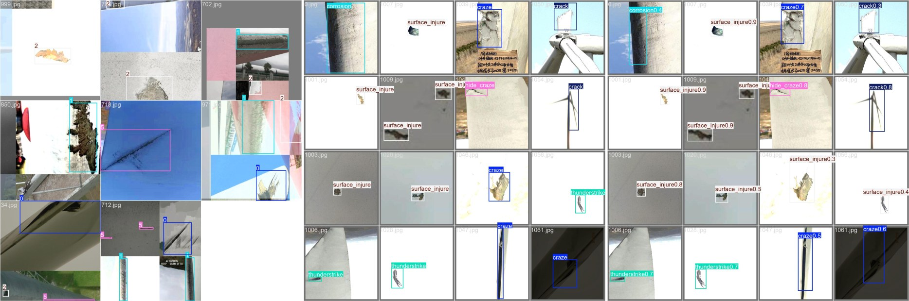{width=100%}

{width=84%}

{width=100%}

# Why leak-free scores are low {#sec:why}

## The annotators against themselves

WTBD's augmented copies were annotated independently, so aligned copies of an image give accidental repeated labels. For every verified pair of the same surface we project each label through the transform (flip-aware ORB + RANSAC similarity, ≥ 25 inliers, at least 8 inliers inside the box) and classify it as agree (same class, IoU ≥ 0.5), class conflict, split, loose or missing. @fig:ambiguity shows examples and @tab:selfconsistency gives the rates.

{width=92%}

: @DEF tab:selfconsistency. Label self-consistency on axis-aligned copies of the same image (rotation within 3° of a multiple of 90°, flips included), where boxes map to boxes and every difference is an annotation difference. Rotated copies and other views of the surface agree less, but those strata also include geometric effects.

| dataset | labels | agree | split | loose | missing | class conflicts | rotated copies | other views |
|---|---|---|---|---|---|---|---|---|
| WTBD | 2,965 | **87.3%** | 4.6% | 6.7% | 1.5% | 0 | 77.9% | 64.1% |
| WTBlade-Defect | 42,812 | **86.0%** | 2.5% | 8.2% | 3.1% | 91 (0.2%) | 80.7% | 59.8% |
| Wind Surface | 10,261 | **83.8%** | 9.2% | 5.9% | 1.1% | 0 | (18 labels) | 44.2% |

So 13–16% of labels disagree with an exactly aligned copy, in all three datasets, including a double-annotated one (κ = 0.897 reported by its authors [@wtbd]). Almost none of it is class. The amorphous classes are the least consistent (@fig:agreement). Counts are per label occurrence and concentrate in a few heavily duplicated scenes. On WTBlade the "missing" rate is mostly a matching artefact of rotating rotors in video (1.1% without dirt). Most of its 91 class conflicts are pasted synthetic patches labelled peeling in one copy and crack in another.

{width=94%}

## Box granularity

On WTBD-group, tolerant AP50 exceeds standard AP50 by +11.9 for BladeYOLO-v2 (56.1 → 68.0) and +12.4 for YOLO12-L (40.0 → 52.4). Most striking is craze, from 9.9 to 66.1. All 15 craze test images are rotated, flipped or recoloured copies of one long leading-edge split, annotated as 2–3 segment boxes (@fig:craze). The same effect holds for RF-DETR scored with classes merged: AP50 rises from 66.1 to 79.7 on WTBD-group and from 50.1 to 61.2 on WTBlade-group (@tab:g28).

{width=78%}

@tab:granularity gives the per-class view for BladeYOLO-v2.

: @DEF tab:granularity. Three box scores on WTBD-group test, in percent (500 scene replicates). Per class: BladeYOLO-v2. The official-split rows use the same scores, and the official-minus-group gap shrinks as the metric becomes split-invariant (BladeYOLO-v2: +25.4, +20.9, +16.8).

| | standard AP50 | tolerant AP50 | region AP |
|---|---|---|---|
| BladeYOLO-v2, WTBD-group | 56.1 [48.3, 79.1] | 68.0 [60.4, 83.1] | 60.3 [55.2, 74.3] |
| YOLO12-L, WTBD-group | 40.0 [33.9, 67.8] | 52.4 [46.5, 74.0] | 44.1 [40.2, 59.2] |
| difference | +16.1 [+2.3, +28.4] | +15.6 [+0.1, +23.7] | **+16.2 [+7.7, +23.6]** |
| BladeYOLO-v2, WTBD official | 81.5 | 88.9 | 77.1 |
| YOLO12-L, WTBD official | 69.0 | 80.0 | 66.6 |
| craze | 9.9 | **66.1** | 42.7 |
| corrosion | 62.6 | 67.6 | 68.4 |
| surface_injure | 75.9 | 81.6 | 68.9 |
| thunderstrike | 100.0 | 100.0 | 68.2 |
| crack | 35.2 | 35.6 | 49.1 |
| hide_craze | 53.0 | 56.8 | 64.5 |

Two limits apply. We hypothesised that part of the leakage inflation is memorised box splitting, and tested it: the tolerant gain is not smaller on test images with a training twin, so the hypothesis is not supported. And training a detector to tolerate splitting does not help overall: blanket split-tolerant training is not an improvement (tolerant AP50 +1.5 [−11.1, +6.4]), and class-selective tolerance raises corrosion by +9.3 [−0.3, +24.6] while the mean moves by −0.4. So the ambiguity limits what can be measured more than what can be trained away.

**Annotators as a ceiling.** Corrosion copies agree on only 69% of labels and models score near that (BladeYOLO-v2 AP50 54–63), so more corrosion "improvement" is largely unmeasurable with these labels. Crack copies agree on 95% while the YOLO family scores 35–39, so crack is a genuine model weakness there.

## Subset luck

At a fixed budget of 25% of scenes, which scenes are labelled matters more than any model effect we measured (@fig:luck). Across 8 random draws, with the same model, recipe and seed, ViT-B test mAP50-95 spans 9.0–19.6 (×2.2), and without DINOv3 it spans 2.6–7.2. The DINOv3 gain holds on 8 of 8 draws (+7.1 [+5.1, +12.6]), and draw quality carries over between models (Spearman ρ 0.71). Yet no label-free subset property we tested predicts it (H7, G16, H20). Label-free scene selection by patch coverage beats random by +5.2 [+1.9, +10.5] but does not separate from FreeSel [@freesel] (+2.1 [−1.2, +9.1], P 0.917, validation opposite).

@tab:selection gives the selection runs at the same 25% budget. Selecting by class balance does worst of the five arms, which suggests that which scenes are labelled matters more than matching class counts.

: @DEF tab:selection. Selection of which 25% of WTBD-group scenes to label: 18 ViT-B runs at the same budget, training seed 0 unless noted. Random draws per run: 11.2, 13.5, 11.8, 12.3, 9.0, 10.0, 12.4, 19.6.

| arm (runs) | test mAP50 | test mAP50-95 | val mAP50-95 | rank among 8 random (test / val) |
|---|---|---|---|---|
| patch coverage, label-free (4) | 40.6 | **17.7** | 23.6 | 2 of 9 / 3 of 9 |
| FreeSel-224 (2) | 42.9 | 15.6 | **27.1** | 2 of 9 / 1 of 9 |
| FreeSel-640 (2) | 34.4 | 14.5 | 26.6 | 2 of 9 / 2 of 9 |
| random (8) | 31.3 | 12.5 | 21.6 | |
| class-matched, uses labels (2) | 25.3 | 10.4 | 19.7 | 7 of 9 / 7 of 9 |

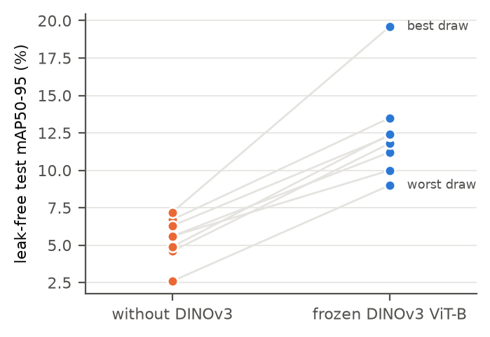{width=72%}

## Error anatomy

Scarce labels fail differently by detector family (@fig:anatomy, in the style of TIDE [@tide]). For each test box we ask whether a same-class box at IoU ≥ 0.5 is among the outputs and how it is scored.

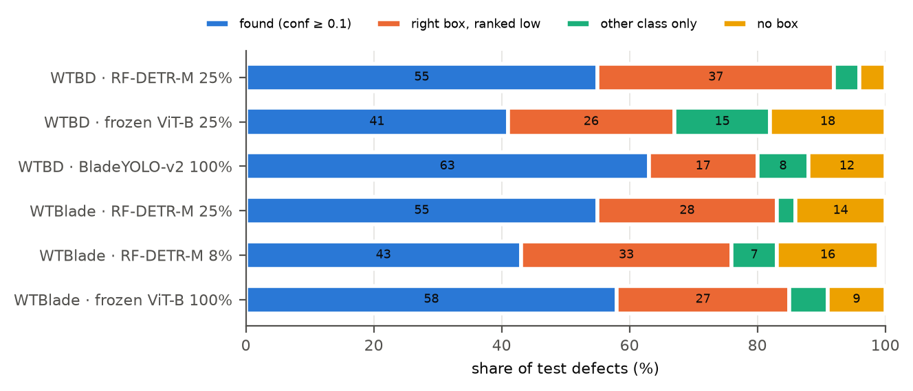{width=84%}

@tab:anatomy gives the numbers and @tab:ceiling the extent comparison.

: @DEF tab:anatomy. Error anatomy, as a share of test boxes. Candidate recall = hit + ranked low. YOLO-family runs keep fewer boxes after NMS (about 50–80 per image) than RF-DETR (about 300), so recall within each image's top 50 boxes is also given.

| dataset | detector | hit | ranked low | other class | no box | candidate recall | in top 50 |
|---|---|---|---|---|---|---|---|
| WTBD | RF-DETR-M 25% (4 subsets) | 0.55 | **0.37** | 0.04 | 0.04 | **0.92** | 0.81 |
| WTBD | ViT-B 25% (4 subsets) | 0.41 | 0.26 | 0.15 | 0.18 | 0.67 | 0.66 |
| WTBD | BladeYOLO-v2 100% (2 seeds) | 0.63 | 0.17 | 0.08 | 0.12 | 0.80 | 0.80 |
| WTBlade | RF-DETR-M 25% (4 subsets) | 0.55 | 0.28 | 0.03 | 0.14 | **0.83** | 0.72 |
| WTBlade | RF-DETR-M 8% (4 subsets) | 0.43 | 0.33 | 0.07 | 0.16 | 0.77 | 0.62 |
| WTBlade | ViT-B 100% | 0.58 | 0.27 | 0.06 | 0.09 | 0.85 | 0.81 |

: @DEF tab:ceiling. Box extent against the annotator ceiling on WTBD (same-class IoU of a label with its copy, or of the best prediction with conf ≥ 0.1, per test box). RF-DETR-M's gap is in finding defects; once found, its boxes match labels as well as a second annotator's do. The YOLO-family runs were extent-limited.

| source | boxes | IoU ≥ 0.5 | of those, IoU ≥ 0.75 | median IoU of those | IoU ≥ 0.75 |
|---|---|---|---|---|---|
| annotators, all copies | 2,965 | 0.87 | 0.70 | 0.83 | 0.61 |
| annotators, test copies | 392 | 0.91 | 0.75 | 0.84 | 0.68 |
| RF-DETR-M 25% (4 subsets) | 940 | 0.55 | 0.67 | 0.83 | 0.37 |
| ViT-B 25% (4 subsets) | 940 | 0.41 | 0.45 | 0.73 | 0.19 |
| BladeYOLO-v2 100% | 235 | 0.63 | 0.47 | 0.74 | 0.29 |

- **RF-DETR at 25% labels proposes the right box for most defects.** Candidate recall is 0.92 on WTBD (above BladeYOLO-v2 at 100%, 0.80) and 0.83 on WTBlade. Its deficit is scoring: 37% of WTBD test defects have a correct box scored below 0.1.
- **On WTBD the rare classes are confused**, with crack missed or mislabelled and thunderstrike found under other classes (54% located as another class, in 4 subsets). On WTBlade, 43–49% of crack boxes lack a same-class box at IoU ≥ 0.5 at every budget (RF-DETR 8%: 0.47; 25%: 0.49; ViT-B 100%: 0.43). So this is not a label-budget problem. Misses concentrate on small boxes (1.00 below 16 px, 0.65 below 32 px, 0.22 above 64 px), and among near-misses the largest share is shifted boxes (44%), not split ones.
- **Not resolution, on WTBD.** Median defect short sides at 640 px are 62–148 px by class.

# Leave-one-dataset-out: data volume does not replace target labels {#sec:lodo}

If label count were the bottleneck, pooling every other blade dataset should help. G28 tests this directly. It was pre-registered before any pool was built or run started.

## Design

For each target T, two class-agnostic RF-DETR-M arms (640 px, cosine, seed 0) are scored on T's test set:

- **ID-T:** T's group train (WTBD 100 epochs, WTBlade 60).
- **X-T:** every other source, twin-free against *all* of T, 12 epochs. Selection uses a held-out 5% of X-T's own images [@domainbed]; T is never seen, not even for selection.

Every image of T is an evaluation key for the twin rule: same file, DINOv2 ≥ 0.90, ORB ≥ 25 inliers, pixel correlation ≥ 0.97 over 8 orientations, and the closure of all of these. GAN images and box-less images are dropped. The rule deliberately sits below the audit's twin thresholds (0.93 and 0.99): earlier versions of this rule, on the G27 pool, kept 830 pixel twins and then neighbouring video frames, and each failure was logged and fixed before any training. @fig:pools shows the result: X-WTBD has 26,065 training images (55,845 boxes across its train and held-out images) and X-WTBlade 14,405 (27,844). @fig:poolaudit shows the closest pairs an independent audit could find; the highest pixel correlation and cosine to any target image are 0.964 / 0.827 and 0.970 / 0.900.

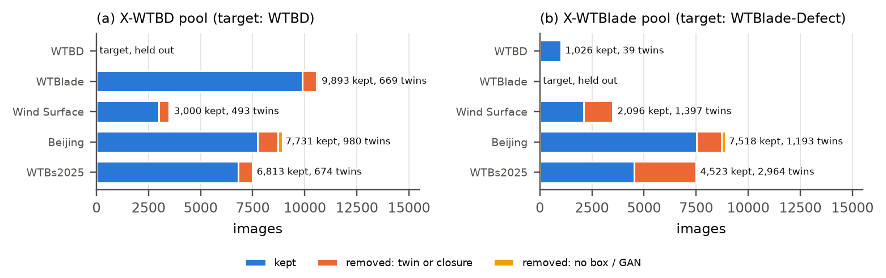{width=90%}

{width=72%}

We define the gaps $G_{\mathrm{std}} = \mathrm{ID} - \mathrm{X}$ in standard AP50 and $G_{\mathrm{reg}} = \mathrm{ID} - \mathrm{X}$ in region AP, and the convention share $1 - G_{\mathrm{reg}} / G_{\mathrm{std}}$, the part of the gap that is about how boxes are drawn. The direction counted as alive only if, on *both* targets, X reached at least 0.80 × ID in region AP and the convention share was at least 0.5. Both bars were judgment calls fixed before any number existed.

## Results

: @DEF tab:g28. G28, class-agnostic, test, scene bootstrap (2,000 replicates). *Ref* is G27 A0 (class-aware, 768 / 640 px), scored with classes merged; reported, not decisive. *Trivial* is one box over the whole image.

| target | arm | train images | AP50 | AP50-95 | tolerant AP50 | region AP | AR50 |
|---|---|---|---|---|---|---|---|
| WTBD-group | ID | 745 | 72.9 [57.6, 86.3] | 41.9 | 84.6 | 68.9 [61.3, 75.4] | 98.7 |
| | X | 26,065 | **17.7** [11.9, 28.4] | 6.0 | 24.2 | 43.6 [37.4, 52.3] | 79.6 |
| | ref | 745 | 66.1 | 40.5 | 79.7 | 65.9 | 97.9 |
| | trivial | | 0.0 | | | 14.0 | |
| WTBlade-group | ID | 2,136 | 51.7 [48.0, 58.8] | 21.5 | 65.1 | 68.7 [62.6, 75.2] | 90.5 |
| | X | 14,405 | **2.4** [0.8, 3.5] | 0.5 | 3.2 | 37.6 [32.5, 45.1] | 38.2 |
| | ref | 2,136 | 50.1 | 21.3 | 61.2 | 68.0 | 92.2 |
| | trivial | | 1.0 | | | 24.2 | |

: @DEF tab:g28-gap. G28 decision. Bars: ratio ≥ 0.80 and share ≥ 0.5 on both targets. ID − X has P(> 0) = 1.000 on every metric of both targets.

| target | X / ID region AP | convention share | $G_{\mathrm{std}}$ [95% CI] | $G_{\mathrm{reg}}$ [95% CI] | verdict |
|---|---|---|---|---|---|
| WTBD-group | 0.63 | 0.54 | +55.2 [+41.7, +66.4] | +25.3 [+14.4, +33.9] | dead |
| WTBlade-group | 0.55 | 0.37 | +49.3 [+45.0, +57.2] | +31.0 [+26.8, +34.6] | dead |

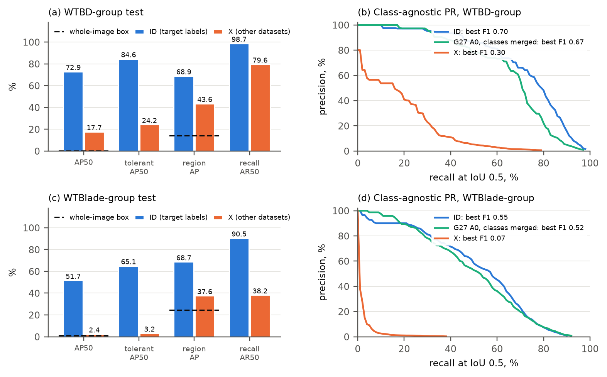{width=98%}

{width=100%}

**The direction fails on both targets.** @tab:g28, @tab:g28-gap and @fig:g28 give the numbers, and @fig:predictions shows examples. With 35× more images from other sources, X still loses to 745 target images by 55 AP50 points on WTBD-group. The convention explains about half of the gap there and about a third on WTBlade-group. The remainder is a real failure to find the defect. Without the residual pixel-twin images of @fig:residual, the decision stays the same (ratio 0.64 and 0.56, share 0.55 and 0.39; ID AP50 71.9 and X 17.1 on WTBD-group).

**The model did train.** X-WTBD reached mAP50 72.2 on its own held-out images at its final epoch, and its region AP is above a trivial detector on both targets (43.6 against 14.0, 37.6 against 24.2). So it does carry information about where defects are. But it is not usable as a detector on an unseen dataset: X-WTBlade's AP50 of 2.4 is barely above boxing the whole image (1.0).

**Why recall and AP disagree on WTBD.** X finds 79.6% of WTBD labels at IoU 0.5 while scoring 17.7 AP50. @fig:g28 (b) shows why: true boxes rank among many false ones. At recall 10%, precision is 54% against 100% for ID; at recall 30% it is 23% against 95%. At its best F1 (0.30), X keeps about one box per image. On WTBlade-group, X's precision at recall 10% is only 3%, against 90% for ID. AR50 is generous because it counts every output, up to 300 per image, and some false positives are genuine damage of kinds T does not label, as noted in the pre-registration, so this test is conservative for X.

**Earlier evidence agrees.** Models trained on one benchmark transfer poorly to the other (@tab:transfer), and an open-vocabulary foundation detector finds almost nothing without training. Pooling many sources raises the WTBD number from 5.2 to 17.7, but these are different models and scoring scopes, not a paired comparison, and on WTBlade-group pooling does not help (2.2–4.0 against 2.4).

: @DEF tab:transfer. Generalisation outside one dataset, earlier experiments (BladeYOLO-v2 models; class-agnostic, damage classes only for transfer).

| setting | result |
|---|---|
| WTBlade model on WTBD-group test | AP50 5.2 (in-domain 56.3, 58.0); difference −52.5 [−69.4, −32.9] |
| WTBD models on WTBlade-group test | AP50 4.0, 2.2 (in-domain 47.5); difference −43.9 [−49.6, −34.6] |
| Mapped classes across datasets | crack 0.0 both ways; thunderstrike / burn at most 7.3 |
| OWLv2 [@owlv2], text queries, no training, WTBD-group | mAP50 3.3 (class-agnostic 5.7); trained on 25%: 25.0–25.7 |
| OWLv2, few-shot prototypes from 25% labels | mAP50 0.6 (class-agnostic 0.5) |

# What did not work {#sec:failed}

The leak-free gap motivated many attempts. Reporting them matters, since a reader should know which common ideas have been tried here and how they fared.

## G27: one recipe for all protocols

Diagnostics said that RF-DETR's extent is at the annotator ceiling, that candidate recall is high and that rare-class scoring is the loss, with post hoc rescoring closed. So G27 changed what the model learns from, with three additions on one pre-registered path:

- **CP:** copy-paste [@copypaste] of real boxes from the same training set to classes below the median count (@fig:copypaste).
- **D1:** in-domain self-supervised adaptation of RF-DETR's DINOv2 encoder by masked feature distillation [@data2vec], on a leak-checked pool of 22,318 images.
- **D2:** a multi-dataset supervised stage 1 on the same pool, with partitioned class slots [@multidataset].

A-1 selected the recipe R on validation, seed 0: the best mean among arms beating A0 on both datasets. A-2 is the primary test claim on seeds 0 and 1: R − A0 > 0 on each dataset, with pooled P(> 0) ≥ 0.95.

![@DEF fig:copypaste. Visual check of copy-paste, as made before training. Some pastes land off the blade where SAM's [@sam2] largest mask includes sky, and box-level pastes carry their source background. These cases were kept, since the A1 − A0 comparison measures the recipe as it ran.](figures/fig25_cp_check.jpg){width=72%}

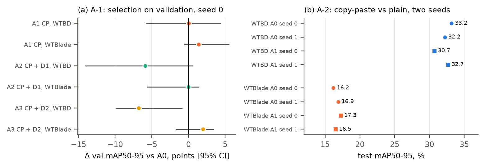{width=94%}

: @DEF tab:g27. G27 A-2, R = A1 (copy-paste), R − A0, test mAP50-95, mean of seeds 0 and 1. The primary claim fails.

| | R − A0 | 95% CI | P(> 0) |
|---|---|---|---|
| WTBD-group | −0.99 | [−8.6, +1.2] | 0.193 |
| WTBlade-group | +0.35 | [−0.5, +1.6] | 0.812 |
| mean over datasets | −0.32 | [−4.1, +0.9] | 0.290 |

As pre-registered, we also score without the residual pixel-twin images: R − A0 is −1.01 on WTBD-group and +0.40 on WTBlade-group, so the conclusion is unchanged.

R = A1 was chosen by +0.04 points on WTBD-group validation, smaller than A0's own seed-to-seed difference on validation. D1 and D2 were rejected on A-1 (−5.9 and −6.8 points against A1 on WTBD val), and a post hoc check found D1 halved the encoder's last-stage effective rank (257 to 135), partial dimensional collapse. A seed swing of up to 2 points on these test sets (A1 on WTBD: 30.7, 32.7) sets the smallest effect that can be claimed.

@tab:g27val gives the validation scores that made the selection, with the test scores beside them.

: @DEF tab:g27val. All G27 arms, mAP50-95 from the G27 scorer. Validation decided R; test was not used for selection.

| arm | WTBD-group val, seed 0 | WTBD-group test, seeds 0 / 1 | WTBlade-group val, seed 0 | WTBlade-group test, seeds 0 / 1 |
|---|---|---|---|---|
| A0 plain | 40.11 | 33.2 / 32.2 | 15.68 | 16.2 / 16.9 |
| A1 + CP | 40.15 | 30.7 / 32.7 | 17.10 | 17.3 / 16.5 |
| A2 + CP + D1 | 34.2 | 27.4 / – | 15.6 | 16.1 / – |
| A3 + CP + D2 | 33.4 | 33.2 / – | 17.7 | 16.6 / – |

## Semi-supervised learning in detail

Label budgets suggested semi-supervision, and it took three rounds to rule out (@tab:ssl). Seed noise alone is ±2.6 mAP50 at 25%, as wide as every effect measured. The class-balanced variant is significantly worse, partly through a confirmation-bias runaway: one seed produced up to about 2,300 pseudo-boxes per epoch from 24 images. Measured against hidden labels, even a good teacher's pseudo-labels are 66% correct at threshold 0.5 and 40% at 0.25.

: @DEF tab:ssl. Teacher–student rounds at 25% of WTBD-group [@meanteacher]. Top: one seed per arm, COCO-style evaluator. Bottom: three seeds per arm.

| arm | test mAP50 / mAP50-95 | val best mAP50 / mAP50-95 | pseudo-labels |
|---|---|---|---|
| supervised | 23.2 / 8.2 | 44.4 / 22.6 | – |
| synthetic views, unlabelled pool | 22.4 / 7.8 | 44.8 / 22.0 | 2,748 |
| real views, unlabelled pool | 19.2 / 7.7 | 38.2 / 18.4 | 961 |
| in-domain (the rest of train, labels hidden) | 20.9 / 8.0 | 45.7 / 22.7 | 1,294 |
| supervised, 3 seeds | 21.3 ± 2.6 / 7.9 ± 1.0 | | – |
| class-balanced in-domain, 3 seeds | 16.3 ± 2.0 / 6.6 ± 0.6 | | 5,957, 28,742, 4,372 |

## The ledger

@tab:ledger lists the method hypotheses we ran or formally gated, with their results. @fig:failed plots those with a test effect in points. Some effects are real but narrow (copy-paste on rare classes in a low-label setting), and few survive a second dataset or a replication.

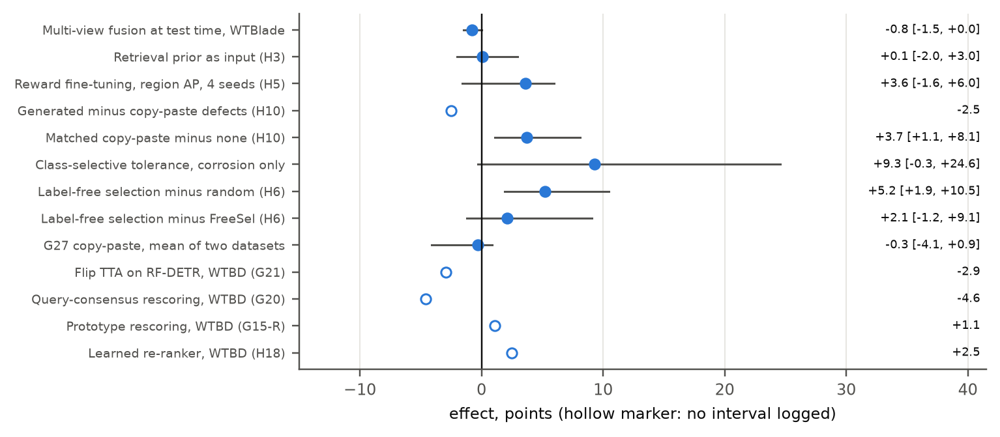{width=90%}

: @DEF tab:ledger. Ledger of method tests and diagnostics. WTBD-group, test mAP50-95 points unless noted. Pre-registered from late October; earlier rounds were decided in advance but not formally committed.

| test | idea | result | verdict |
|---|---|---|---|
| Phases 22–24 | Teacher–student with synthetic or real views, in-domain, class-balanced [@meanteacher]; 3 seeds | balanced in-domain 6.6 vs supervised 7.9; mAP50 −4.2 [−12.1, −0.3]; confirmation-bias runaway on one seed | fails |
| Phase 24 | SAM 2.1 box refinement [@sam2] | +0.3 to +0.5 at 25%, −0.2 at 100% | fails |
| Phases 18, 26 | Split-tolerant training; class-selective version, 2 seeds | blanket not an improvement; corrosion +9.3 [−0.3, +24.6], mean −0.4 | targeted only |
| H1 | Multi-view fusion at test time | not testable on WTBD (26 images with a second view); WTBlade-group −0.8 [−1.5, 0.0] | fails |
| H2 | Normal-blade anomaly prior | most anomalous patches not on defects; box recall below chance | fails |
| H3 | Retrieval prior as a detector input | +0.1 [−2.0, +3.0] | fails |
| H4 | Test-time adaptation across real views | gate failed: real views do not make better detections | not run |
| H5 | Reward fine-tuning, granularity-invariant reward; 4 seeds + WTBlade | region AP +3.6 [−1.6, +6.0], P 0.896; WTBlade −0.6 | fails on replication |
| H6 | Label-free scene selection by patch coverage | +5.2 [+1.9, +10.5] over random; +2.1 [−1.2, +9.1] over FreeSel | no gain over prior art |
| H7 | Label-free property predicting subset quality | no property survives correction | fails |
| H8, H9 (G8, G9) | Feature upsampling; high-frequency cues | −5.9; −0.1 (mean AP) | fail |
| H10 | Generated rare-class defects vs matched copy-paste | synth − paste −2.5; paste − none +3.7 [+1.1, +8.1] | generation fails; copy-paste helps here |
| H12 | DINOv3 reduces subset luck | it does not; draw quality carries over (ρ 0.71) | fails |
| G15, G15-R | Prototype rescoring | WTBD +1.1; WTBlade −0.7 | fails bar; prior art |
| G16, G16-R | Instance-level proximity law; explains subset luck? | law holds at instance level; does not explain subset luck; on RF-DETR it holds for confidence, not for detection | partial |
| H16b | Deployment-targeted scene selection | gate failed | not run |
| G17 | Clicks as pseudo-boxes (bar: 60% at IoU ≥ 0.5) | 42.0% | fails |
| H18, -R, -W | Learned coverage-aware re-ranker on RF-DETR | WTBD +2.5, replicated on new models; WTBlade +0.2 | WTBD only |
| H19-W | Rescoring at the low-count boundary, WTBlade 8% | −0.2 [−1.3, +0.7], P 0.286 | fails |
| G20 | Query-consensus rescoring | −4.6 WTBD; −2.1 WTBlade | fails |
| G21 | Flip agreement; plain flip TTA on RF-DETR | −2.9 WTBD; −0.6 WTBlade | fails; TTA hurts this DETR |
| G22, -O | Fine-tuning moves proximity from recall to ranking | controlled confirmation on WTBD; not on WTBlade; holds only for generic-feature proximity | does not replicate |
| H20 | Subset luck as annotation-convention match | no relation | fails |
| G24 | Input resolution 768 vs 576 | WTBD +1.0 (P 0.958); WTBlade −0.1 | dataset-specific |
| V1 | RF-DETR replaces the frozen-feature detector at 25% | +7.3 [+2.3, +11.9]; +8.3 [+4.5, +15.0] | passes |
| Box extent; crop re-classifier | Better box refinement; re-classifying RF-DETR candidates | prior-art and ceiling checks show little room | discarded before any run |
| G25, G26 | Official-protocol benchmark; tuned recipe | @tab:official, @tab:tuning | reported |
| G27 | CP, D1, D2 recipe | A-2 −0.32, P 0.290 | fails |
| G28 | Leave-one-dataset-out | dead on both targets | fails |

# A cautionary history: how our own numbers were wrong {#sec:history}

We report this because the same traps face anyone working on these datasets. @fig:history gives the sequence, and @tab:runs the original runs.

{width=92%}

: @DEF tab:runs. Early runs on the original Wind Surface split (2,856 train / 714 val). Later analysis invalidated the conclusions drawn from them.

| run | architecture | epochs | mAP50 | mAP50-95 | outcome |
|---|---|---|---|---|---|
| 1–2 | paper-faithful: DINOv3 + Style Injection + WTConv + Cross-Mamba | crash, ~200 | | | bf16, unfreezing and DDP failures; NaN from FFT gradients |
| 3 | paper-faithful, FFT detached, SGD | ~283 | ~52.6 | ~28 | stagnated; closest reproduction |
| 4 | BladeYOLO-S (8 M parameters) | 400 | 64.3 | 37.3 | apparent ceiling at about 64 |
| 6 | BladeYOLO-L (57.2 M), AdamW | 400 | 78.2 | 46.9 | looked like a breakthrough |
| 7 | Run 6 + "Cross-Scale Vision Mamba" + WIoU v3 | 400 | 77.0 | 47.8 | "+0.9 from WIoU" |

The gap of 33.9 / 29.4 points between Run 3 and the published 86.5 / 57.4 is far beyond run-to-run variance. These runs used a weakened feature extractor (below) and the leaky split, so they support "not reproducible from the published information", and not "the published modules do not work". The paper reports 3,790 images while the public copy has 3,570, and gives no split seed, image list or code.

**Then we audited our own code.** Run 7 was not the model we described:

- **WIoU never ran**, because the patch reached the wrong namespace, so Run 7 trained with CIoU. Its "+0.9 mAP50-95 from WIoU" was invalid. The formula also had three errors.
- **The "Mamba" block did not perform a selective scan.** It was replaced by a four-direction implementation that matches a reference recurrence to 1.8e-14.
- **The DINOv3 extractor skipped RoPE and fed unnormalised pixels**, so every run before 9 October used weakened features.
- **The wavelet branch discarded high-frequency detail.**

**Then we found the leak.** Removing it took the numbers from about 78 to about 36–40 on a merged, deduplicated dataset (v2, 2,606 unique images from 11,681), and a larger taxonomy-mapped v3 (5,777 images) scored only 26–32. An exhaustive label review of 763 candidates was worth only +3 mAP50 points. v3's limit was structural: its classes rest on few independent scenes, and one had a single training group. Only then did the audit lead us to WTBD alone, with its native classes.

@tab:corrections in the appendix lists all conclusions we later corrected. Several were our own favourite explanations.

# Recommendations

1. **Split by scene, and deduplicate before augmenting.** Never augment before a split. Group by source photo, video and tile, and add a pixel test: retrieval and keypoints alone missed photometric copies in our own splits.
2. **Publish image lists**, not just ratios. The BladeYOLO 0.87-ratio question cannot be settled without one.
3. **Report a leaked / no-twin breakdown** for any dataset with known copies. It takes minutes with cached predictions, and our tools are public.
4. **Do not tune on a leaky test set.** On these splits tuning measurably moved scores towards memorisation. Tune on a scene-separated validation set.
5. **Use scene-level intervals.** A 161-image test set with 58 scenes, and some classes in fewer than 3 scenes, cannot support per-class claims.
6. **Report several labelled subsets for low-label claims.** A factor of two between random draws is larger than any model effect we saw.
7. **Report seeds.** On these test sets, seed swings of up to 2 mAP50-95 points match the size of most claimed gains.
8. **Calibrate on unseen scenes.** A recall guarantee calibrated on seen scenes does not hold in the field.
9. **Report a granularity-invariant score beside box AP** for amorphous defects, and measure label self-consistency where copies exist.
10. **Test every method on a second dataset.** Several of our effects held on WTBD and vanished on WTBlade, and vice versa.
11. **Check licences at the source**, since export pages can misstate them.

# Limitations {#sec:limits}

- **Single wind farm per dataset; small test sets** (58 and 177 test scenes). Our leak-free numbers carry wide intervals.
- **Official-protocol runs are single seed**, and their intervals are image-level.
- **The tuning analysis is post hoc and covers one step**, with epochs confounded on two of three protocols.
- **Wind Surface's "no twin" subset is not leak-free** (it shares drone photos with train), and WTBD's has too few boxes of three classes.
- **WTBlade-group frames retain Roboflow's offline augmentation.** We keep one copy per source, so some test frames are rotated or have black cutouts (@fig:predictions). This is a remaining difference from clean imagery, not a leak.
- **YOLO12-L on WTBlade-group may be under-trained:** 50 epochs, the budget planned for BladeYOLO-v2 ViT-B on this set, with its best validation at epoch 43 after a nearly linear rise. Its 13.3 may understate it.
- **Our leak-free splits have a small residual leak** (§[-@sec:benchmarks], @fig:residual): under a point on WTBD-group, negligible on WTBlade-group. G28's ID arm benefits from it slightly.
- **G27 A-2 uses two seeds; G28 uses one.** G28 X arms train for 12 epochs, as G27's stage 1, at 640 px. X-WTBlade loses the largest source, and its pool is 45% smaller than X-WTBD's, which may contribute to the difference between targets.
- **Hardware differs between seeds.** G27 seed 0 ran on Kaggle (fp16) and seed 1 on an A100 (bf16). Arms are paired within a seed, but the seed effect includes hardware. An earlier A0 seed-1 run on Kaggle scored 31.2 on WTBD-group test against 32.2 on the A100.
- **Region AP depends on defect size.** A trivial whole-image detector scores 14–24 here, so raw region AP must be read against that floor.
- **Claims about modules are for our components.** BladeYOLO's own modules were not rerun on a leak-free split after the code audit.
- **Deviations from pre-registration.** The G26 rule formally selected RF-DETR-L (validation 63.4 against 62.0), which lost on test (−1.7), and we did not run L on the other protocols; this cannot inflate a reported number, but it is a deviation. G27's phase B on the official protocols was not run, since the recipe failed A-2.
- **The literature check is not exhaustive**, and "new for this domain" means that we did not find an earlier audit.

# Data and code availability {#sec:availability}

**Code and records.** All code, tests, split files, per-image flags and the full research log (`research_log.md`) are at <https://github.com/bhavya-goel-11/BladeYOLO>. To regenerate this paper's numbers and figures, run `tools/official_leak_eval.py`, `tools/g27_score.py`, `tools/g28_score.py`, `tools/paper_evidence.py`, `tools/paper_figures.py`, `tools/paper_figures2.py` and `tools/build_paper.py`. The training queue is `tools/sessions.sh`.

**Data.** The datasets, leak-free splits and pools are assembled as `blade-defect-benchmark`, with per-folder licences in its `LICENSES.md`. WTBD is CC BY 4.0. WTBlade-Defect contains DTU NordTank images [@shihavuddin] under CC BY-NC, despite its Roboflow page, and derived folders inherit this, so they are for non-commercial research only. The Wind Surface licence is unclear from its source. Images in our figures are shown for scientific comment; sources are cited above.

**Foundation models.** We acknowledge DINOv3 [@dinov3], used under the DINOv3 License, and DINOv2 [@dinov2] through RF-DETR [@rfdetr]. Trained checkpoints containing DINOv3 weights must ship with that licence.

# Appendix {-}

## A. Corrections to our own conclusions {-}

: @DEF tab:corrections. Conclusions we later corrected. Kept here because each was plausible at the time.

| earlier conclusion | status | why |
|---|---|---|
| Runs 6–7 reach ~78 / ~47 on Wind Surface | invalid | 75% of validation had train twins (first count) |
| WIoU v3 gave +0.9 mAP50-95 | invalid | never active; Run 7 trained with CIoU |
| Mamba added global context | invalid | the block did not scan |
| SGD → AdamW was the breakthrough | confounded | changed together with an 8 M → 57 M scale-up |
| The remaining gap is locality bias | superseded | the gap was leakage and data structure |
| v3 is better because it is larger | superseded | scenes matter, not files (Wind Surface 81; WTBD 550) |
| Mislabelling explains poor v3 scores | rejected | the review was worth only +3 mAP50 points |
| BladeYOLO-v2's win shows the architecture generalises | qualified | it rests mainly on thunderstrike (3 test scenes) |
| The advantage comes from the architecture | rejected | the frozen DINOv3 features carry it all |
| Honest calibration costs 2.4 vs 1.0 false alarms per image | corrected | that column counted all predictions; real false alarms 0.2 vs 0.1 |
| WTBD copies agree on 86.0% | refined | rotated copies inflate "loose"; axis-aligned 87.3% |
| Part of the inflation is memorised box splitting | not supported | tolerant gain is not smaller on images with a twin |
| At 25%, most lost defects are found but boxed differently | refined | near-misses (34–36%) and misses (19–27%) are of similar size |
| Split tolerance helps corrosion | replicated, not significant | +9.3 [−0.3, +24.6]; aggregate unchanged |
| The DINOv3 advantage is a low-data advantage | corrected | absolute gain does not shrink with data |
| The gain grows with frozen backbone size | partly supported | ViT-B beats ViT-S; ViT-L does not beat ViT-B |
| Teacher–student gives a small consistent gain | qualified | seed noise was as large; balanced variant significantly worse |
| Leak-free mAP50-95 / mAP50 ratios are 0.42–0.47 | corrected | full-label RF-DETR on WTBD-group reaches 0.60 |

## B. Engineering problems that affected results {-}

: @DEF tab:engineering. Defects we found and fixed. Several of them silently changed what was being measured. Mixed-precision overflow was the most frequent.

| problem | root cause | fix |
|---|---|---|
| WIoU never active | patched the wrong namespace | patch the loss namespace |
| NaN in selective scan (epoch 9) | fp16 overflow before LayerNorm | fp32 LayerNorm |
| NaN at epoch 4 | poisoned WIoU running mean; aggressive warm-up | finite-only mean; lr 0.001, bias warm-up 0 |
| NaN at epoch 17 | fp16 overflow from a conv into BN | fp32 blocks for refinement |
| NaN at epoch 99, validation at 0 | NaN batch poisons BN statistics and EMA | per-batch BN repair and step skip, reported |
| NaN late in training (epochs 99–149) | YOLOv12 area attention forms scores in fp16 (~4e5, above the fp16 maximum) | scores and softmax in fp32 |
| Test metrics silently missing | `deform_conv2d` segfault on NaN offsets from the FLOPs probe's uninitialised image | finite, clamped offsets; test in a fresh process |
| Silent resume from an old checkpoint | training script reused any `last.pt` | explicit `--resume` |
| RF-DETR learning rate never decayed | default step at epoch 100 never fires | explicit cosine schedule (G26) |
| Scorer read a stale result after a time-out | an earlier output file had the same name | rerun with no limit; check file freshness |

## C. Notation and experiment names {-}

Names follow the research log: H*n* and G*n* are hypotheses and gates in order of registration. A0–A3 are the G27 arms: A0 plain recipe, A1 + copy-paste, A2 + copy-paste + D1, A3 + copy-paste + D2. ID and X are the G28 arms. "Points" are percentage points of AP. WTBD-official is WTBD's own split.

## D. Per-class audit {-}

: @DEF tab:perclass-audit. Content audit by native class (`runs/analysis/datasets/report.md`). *Learnable* boxes are those kept after deduplication. *Purity* is mutual crop retrieval within the class. Median box size is in pixels at 640. The check export of Beijing is omitted because it is the same data.

<!--AUDIT-->

## E. Run registry {-}

: @DEF tab:newruns. Runs of the final phase (G27, G28, YOLO12-L). Val best is the best EMA epoch (Ultralytics best epoch for YOLO12-L). Test values are from @tab:leakfree and @tab:g28.

| run | data | epochs (best) | val best mAP50 / mAP50-95 | test mAP50 / mAP50-95 |
|---|---|---|---|---|
| `rfdetrm768cos_wtbd_group_full` | WTBD-group, A0, s0 | 100 (20) | 64.8 / 40.4 | 55.3 / 33.2 |
| `rfdetrm768cos_wtbd_group_full_s1` | WTBD-group, A0, s1 | 100 (32) | 67.1 / 40.8 | 54.8 / 32.2 |
| `rfdetrm768cos_cp_wtbd_group_full` | WTBD-group, A1, s0 | 100 (9) | 63.9 / 40.1 | 51.5 / 30.7 |
| `rfdetrm768cos_cp_wtbd_group_full_s1` | WTBD-group, A1, s1 | 100 (31) | 70.7 / 41.8 | 58.5 / 32.7 |
| `rfdetrm768cos_cp_d1_wtbd_group_full` | WTBD-group, A2 | 100 (63) | 59.6 / 34.4 | 49.6 / 27.4 |
| `rfdetrm768cos_cp_d2_wtbd_group_full` | WTBD-group, A3 | 100 (40) | 56.8 / 33.8 | 55.3 / 33.2 |
| `rfdetrm640cos_wtblade_group_full` | WTBlade-group, A0, s0 | 60 (11) | 38.4 / 15.7 | 38.5 / 16.2 |
| `rfdetrm640cos_wtblade_group_full_s1` | WTBlade-group, A0, s1 | 60 (17) | 41.1 / 16.2 | 41.0 / 16.9 |
| `rfdetrm640cos_cp_wtblade_group_full` | WTBlade-group, A1, s0 | 60 (13) | 41.6 / 17.1 | 41.8 / 17.3 |
| `rfdetrm640cos_cp_wtblade_group_full_s1` | WTBlade-group, A1, s1 | 60 (16) | 41.3 / 16.9 | 39.3 / 16.5 |
| `rfdetrm640cos_cp_d1_wtblade_group_full` | WTBlade-group, A2 | 60 (16) | 39.2 / 15.7 | 40.1 / 16.1 |
| `rfdetrm640cos_cp_d2_wtblade_group_full` | WTBlade-group, A3 | 60 (8) | 44.2 / 17.8 | 41.7 / 16.6 |
| `rfdetrm640ag_id_wtbd_group` | ID-WTBD, class-agnostic | 100 (23) | 80.7 / 48.3 | 72.9 / 41.9 |
| `rfdetrm640ag_id_wtblade_group` | ID-WTBlade, class-agnostic | 60 (26) | 49.5 / 20.5 | 51.7 / 21.5 |
| `rfdetrm640ag_x_wtbd_group` | X-WTBD, class-agnostic | 12 (12) | 72.2 / 38.6 (own val) | 17.7 / 6.0 |
| `rfdetrm640ag_x_wtblade_group` | X-WTBlade, class-agnostic | 12 (12) | 62.1 / 33.6 (own val) | 2.4 / 0.5 |
| `yolo12l_wtblade_group` | WTBlade-group | 50 (43) | 33.6 / 12.5 | 32.2 / 13.3 |

: @DEF tab:registry. Registry of earlier runs, as kept in the research log (§27 there; section references inside this table are to the log). Scores are fractions, not percent.

<!--REGISTRY-->

# References {-}
